 

 

 

  
<code>+ x86 / 8051 Assembly</code>

 

 

 
<b><code>QUICKDRAW</code></b> · <b><code>PULL SHARK</code></b> · <b><code>PAIR EXTRAORDINAIRE</code></b> · <b><code>YOLO</code></b> · <b><code>GALAXY BRAIN</code></b> · <b><code>STARSTRUCK</code></b> · <b><code>PUBLIC SPONSOR</code></b>

 

<picture>
  <source media="(prefers-color-scheme: dark)" srcset="https://raw.githubusercontent.com/thejynxx/thejynxx/output/github-contribution-grid-snake-dark.svg"/>
  <source media="(prefers-color-scheme: light)" srcset="https://raw.githubusercontent.com/thejynxx/thejynxx/output/github-contribution-grid-snake.svg"/>
  
</picture>

  

