 

 

 

<b><code>LANGUAGES</code></b>  

 <code>+ x86 / 8051 Assembly</code>

  

<b><code>FULL-STACK &amp; CLOUD</code></b>  

  

<b><code>AI / ML &amp; TOOLING</code></b>  

 

 

 

<picture>
  <source media="(prefers-color-scheme: dark)" srcset="https://raw.githubusercontent.com/thejynxx/thejynxx/output/github-contribution-grid-snake-dark.svg"/>
  <source media="(prefers-color-scheme: light)" srcset="https://raw.githubusercontent.com/thejynxx/thejynxx/output/github-contribution-grid-snake.svg"/>
  
</picture>

 

  

